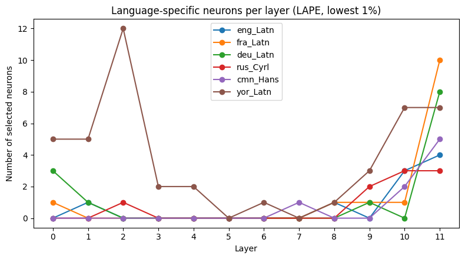

# Language-Specific Neurons in mBERT

Does multilingual BERT have feed-forward neurons that specialise by language, and do they matter causally? Using Language Activation Probability Entropy (LAPE), we find a small set of language-specific neurons in `bert-base-multilingual-cased` for six languages (English, French, German, Russian, Mandarin, Yoruba), and test them by ablation against layer-matched random controls.

## Findings

- **Sparse.** Of 36,864 FFN neurons, the lowest-entropy 1% (368) were kept. 98 of them were assigned to exactly one language (none to several); the other 270 fired strongly in no single language. Yoruba has 45 neurons, the others 8–14.
- **Located in the last layers**, mostly 10–11. Yoruba is the exception: 26 of its 45 neurons are in layers 0–4.
- **Causal.** Zeroing a language's neurons raises its own masked-LM loss far more than zeroing the same number of random unassigned neurons per layer. Effects on other languages are tiny (at most 0.013 nats).
- **Aligned with language directions.** The neurons' output weights lie closer to the span of language-mean representations (mean r = 0.222) than random neurons do (0.069).
- **Stable.** Removing German and re-selecting changes the French set only slightly (Jaccard 0.71).

| Language | Neurons | Baseline loss | Loss increase (selected) | Loss increase (random control) |
|---|---|---|---|---|
| English | 9 | 2.703 | +0.015 (0.5%) | +0.001 |
| French | 14 | 2.079 | +0.134 (6.4%) | +0.001 |
| German | 13 | 2.146 | +0.039 (1.8%) | +0.002 |
| Russian | 9 | 1.767 | +0.079 (4.4%) | +0.000 |
| Mandarin | 8 | 2.001 | +0.082 (4.1%) | +0.001 |
| Yoruba | 45 | 3.478 | +0.151 (4.3%) | +0.020 |

Full matrices (all ablated × evaluated language pairs) are in `results/`.



## Method

1. Record each neuron's activation probability per language on FLORES+ `dev` (12 layers × 3072 neurons, positive GELU outputs over real word pieces).
2. LAPE: normalise each neuron's probabilities across languages, compute entropy, keep the lowest 1%. Assign a kept neuron to a language if its probability exceeds the 95th percentile of all probabilities (τ ≈ 0.44).
3. Ablate (zero) a language's neurons with forward hooks and measure masked-LM loss on the first 300 FLORES+ `devtest` sentences per language (masks drawn once, shared across conditions).
4. Control: same number of neurons per layer, sampled from neurons assigned to no language, averaged over 3 draws.

Selection uses `dev` and evaluation uses `devtest`, so there is no overlap.

## Run

```bash
pip install -r requirements.txt
export HF_TOKEN=...   # FLORES+ is gated: accept its terms on Hugging Face first
python run_experiment.py
```

Writes tables and figures to `results/`. The numbers above come from the original run on a GPU.

## Limitations

- 300 sentences per language, one masking seed, and only 3 control draws. Differences below about 0.003 nats are within control noise.
- The English effect is small (9 neurons). The Yoruba control is larger because its neurons sit in early layers, where random ablation hurts more, but the selected effect still exceeds it by 0.13.
- Six languages and one model. Not tested on other multilingual models or more languages.

Method: Tang et al. (2024), *Language-Specific Neurons: The Key to Multilingual Capabilities in Large Language Models*.
